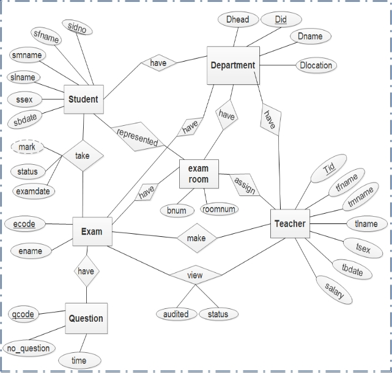
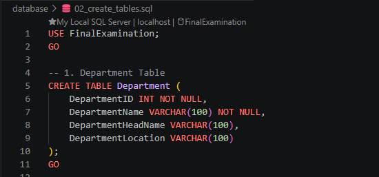
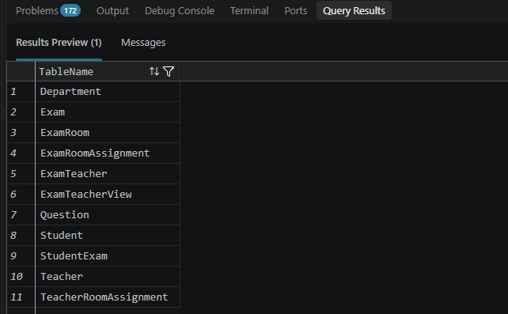
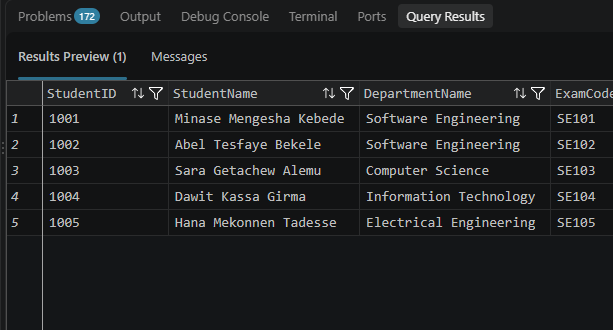

# Final Examination Management System

A relational database project developed using Microsoft SQL Server to manage university final examinations, students, departments, teachers, examination rooms, questions, examination results, and examination auditing.

## 📌Project Overview

The Final Examination Management System is designed to organize and manage university examination-related information through a structured relational database.
The project focuses on database design, implementation, data integrity, SQL programming, and database administration.
It demonstrates how relational database concepts can be applied to manage examination information efficiently and consistently.

## 🎯 Project Objectives

- Design and implement a relational database.
- Manage student and department information.
- Organize teachers and examination rooms.
- Manage examinations and examination question papers.
- Record student examination participation and results.
- Manage teacher assignments and examination reviews.
- Implement SQL Views, Stored Procedures, and Triggers.
- Demonstrate database backup and recovery.

## Technologies

- Microsoft SQL Server
- SQL Server Management Studio (SSMS)
- Visual Studio Code
- Git
- GitHub

## 🗂️ Database Overview

The database consists of 11 relational tables organized to manage the following entities and relationships:

- Department  - StudentExam
- Student     - ExamRoomAssignment
- Teacher     - ExamTeacher
- ExamRoom    - TeacherRoomAssignment
- Exam        - ExamTeacherView
- Question 

## ⚙️ Key Database Features

- Entity Relationship Modeling (ERD)
- Relational Database Design
- Database Normalization
- Primary Keys and Foreign Keys
- Composite Primary Keys
- Unique and Check Constraints
- SQL Queries and Joins
- Database Views
- Stored Procedures
- Database Triggers
- Database Backup and Recovery

## Project Structure

Final-Examination-Management-System/
 - .gitignore
 - LICENSE
 - README.md
- docs/
    - project-description.md
    - requirements.md
    - ERD.png
    - relational-schema.md
    - normalization.md
- database/
    - 01_create_database.sql
    - 02_create_tables.sql
    - 03_constraints.sql
    - 04_insert_data.sql
    - 05_queries.sql
    - 06_views.sql
    - 07_stored_procedures.sql
    - 08_triggers.sql
    - 09_database_recovery.sql
- screenshots/
    - database.png
    - tables.png
    - query_results.png

## 🚀 Getting Started
### Prerequisites

Before running this project, make sure you have:

- Microsoft SQL Server installed.
- SQL Server Management Studio (SSMS) or a compatible SQL development environment.
- Git installed (optional, for cloning the repository).

### Installation

1. Clone the repository:
   git clone https://github.com/minasemengesha/final-examination-management-system.git
   cd final-examination-management-system
2. Open the project folder in Visual Studio Code or SSMS.
3. Navigate to the database/ directory.
4. Execute the SQL scripts in the following order:
                   
- 01_create_database.sql     
- 02_create_tables.sql     
- 03_constraints.sql           
- 04_insert_data.sql     
- 05_queries.sql  
- 06_views.sql        
- 07_stored_procedures.sql 
- 08_triggers.sql            
- 09_database_recovery.sql

Note: Review the backup file location in 09_database_recovery.sql and adjust it to match your SQL Server environment.

## 📚 Documentation

- [Requirements](docs/Client-Interview-Form.pdf)
- [Project Description](docs/Project-Documentation.pdf)
- ERD

- [Relational Schema](docs/Client-Interview-Form.pdf)
- [Normalization](docs/Project-Documentation.pdf)

## 📸 Screenshots

### Database

### Tables

### Query Results

## 👨‍💻 Author

Minase Mengesha

## 📄 License

This project is licensed under the MIT License — see the [LICENSE](LICENSE) file for details.